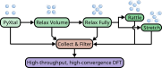

[](https://doi.org/10.21105/joss.11133) [](https://assyst.readthedocs.io/stable/?badge=stable) [](https://codecov.io/gh/eisenforschung/assyst)

# ASSYST or _Automated Small SYmmetric Structure Training_

A flexible reference implementation of the ASSYST method to generate transferable training data for machine learning
potentials.

ASSYST is the Automated Small Symmetric Structure Training, a training protocol, aimed at providing comprehensive,
transferable training sets for machine learning interatomic potentials (MLIP) automatically. A detailed explanation and
verification of the method can be found in our papers.
[[1]](https://doi.org/10.1038/s41524-025-01669-4)[[2]](https://doi.org/10.1103/PhysRevB.107.104103) ASSYST gives up the notion of fitting potentials to
individual phases or structures and instead tries to deliver a training set spanning the full potential energy surface
(PES) of a material.

This software package is a minimal implementation of this idea, designed to be as flexible as possible without assuming
either a specific MLIP, reference data, or workflow manager in mind.
It is built on [ASE](https://ase-lib.org/index.html) and can use any of its calculators.
It also assumes that you label its output structures with reference energies and forces on your own, either with an ASE
calculator or by any other method.
For a ready-to-run implementation that targets Atomic Cluster Expansion and Moment Tensor
Potentials fit to Density Functional Theory (DFT) data check out pyiron_potentialfit.

Development happens on [Github](https://github.com/eisenforschung/assyst).
Please submit bugs, usage questions, or feature requests directly via [Github Issues](https://github.com/eisenforschung/assyst/issues/new).
For bug reports please include which version of `assyst` you are using and, if
possible, a small code snippet that reproduces the issue.
We are open for any contributions!
Feel free to open [Pull Requests](https://github.com/eisenforschung/assyst/pulls) directly or get in touch via
the issues.



## Citation

Please use the following citation when referencing the method in your work or use [this file](CITATION.ciff).

```
@article{Poul2026,
  title={ASSYST: A Python package for automated generation of training data for machine learning interatomic potentials},
  volume={11},
  ISSN={2475-9066},
  url={http://dx.doi.org/10.21105/joss.11133},
  DOI={10.21105/joss.11133},
  number={127},
  journal={Journal of Open Source Software},
  publisher={The Open Journal},
  author={Poul, Marvin and Neugebauer, Jörg},
  year={2026},
  month=Nov,
  pages={11133}
}
```
